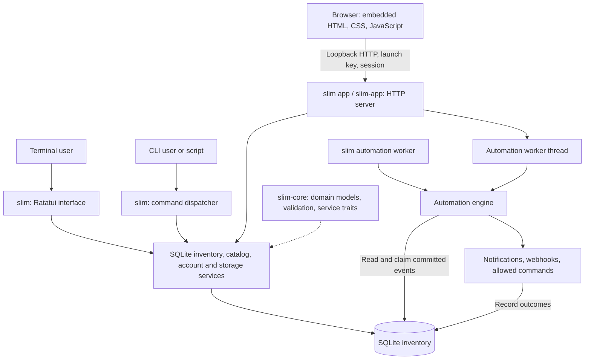
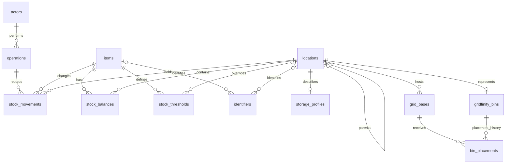

# SLIM — System for Local Inventory Management

SLIM is a local inventory application written in Rust. It tracks items, storage locations, quantities, and movement history in an embedded SQLite database. A Ratatui terminal interface, a local browser interface, and a command-line interface share the inventory services.

**Application version:** 0.3.0 · **Database schema:** 8 · **Rust edition:** 2024 · **License:** MIT

Core inventory workflows run offline. Building from source downloads dependencies; configured webhooks need access to their receivers. No cloud account, database server, JavaScript build pipeline, or external asset CDN is required.

## Contents

- [Capabilities and scope](#capabilities-and-scope)
- [Quick start](#quick-start)
- [Installation](#installation)
- [Build from source](#build-from-source)
- [First use and interfaces](#first-use-and-interfaces)
- [System architecture](#system-architecture)
- [Database architecture](#database-architecture)
- [Configuration and data locations](#configuration-and-data-locations)
- [CLI walkthrough](#cli-walkthrough)
- [Backups, restore, and upgrades](#backups-restore-and-upgrades)
- [Automation and hardware](#automation-and-hardware)
- [Security model](#security-model)
- [Development and verification](#development-and-verification)
- [Release packaging](#release-packaging)
- [Troubleshooting](#troubleshooting)
- [Code review walkthrough](#code-review-walkthrough)
- [License](#license)

## Capabilities and scope

| Area | Implemented behavior |
| --- | --- |
| Inventory | Items with optional SKUs, descriptions, units, minimum stock, labels, and barcode associations |
| Storage | Hierarchical rooms, cabinets, drawers, shelves, bins, compartments, and custom storage with dimensions and notes |
| Stock | Receive, issue, transfer, and counted adjustments with attributed movement history |
| Gridfinity | Baseplates, bin footprints, placement history, rotation, bounds validation, and collision checks |
| Accounts | Viewer, Operator, Manager, and Admin roles; PINs, badges, sessions, removal and reactivation |
| Reliability | Atomic stock writes, retry receipts, reconciliation, consistent backups, and versioned migrations |
| Automation | Persisted events, notification results, HTTP/HTTPS webhooks, and explicitly enabled command actions |
| Devices | Device registration, serial input, reviewed observations, and logical dock LED/presence state |

SLIM is designed for a local computer. The browser server listens only on loopback. Multiple local processes can use the same inventory, with SQLite coordinating writes. Physical controller operation requires compatible hardware, transport, and firmware beyond the logical database state.

## Quick start

### Run the existing Mac build

From the source folder, if the native release executables are present:

```sh
cd /path/to/SLIM
./target/release/slim --config config.example.toml --db my-inventory.db tui
```

For the browser, select the same database explicitly:

```sh
./target/release/slim --config config.example.toml --db my-inventory.db app
```

The review checkout starts with an empty `my-inventory.db`. First launch asks you to create an owner and PIN. Generated executables and databases are excluded from source-only distributions; [build first](#build-from-source) if these paths do not exist.

### Run a prebuilt release

Extract the archive for your operating system and CPU, then run its installer. Prebuilt packages do not require Rust. See [Installation](#installation) for portable execution and installed paths.

## Installation

### macOS

Choose the archive matching the Mac that will run SLIM:

| Mac | Archive produced by the packaging script | Rust target |
| --- | --- | --- |
| Apple Silicon | `SLIM-macOS-arm64.zip` | `aarch64-apple-darwin` |
| Intel | `SLIM-macOS-x86_64.zip` | `x86_64-apple-darwin` |

Run `uname -m` to inspect the current shell's architecture. Build from a native shell; Rosetta can report `x86_64` on Apple Silicon.

1. Extract the matching archive.
2. Double-click **Install SLIM.command**, or run `bash "Install SLIM.command"` from the extracted folder.
3. The installer copies the app to `~/Applications/SLIM.app` and the terminal launcher to `~/Applications/Start SLIM.command`, then starts the terminal interface.
4. Subsequently, open **Start SLIM.command** for the terminal or **SLIM.app** for the browser.

The installer checks the packaged browser executable's architecture. Local packages are ad-hoc signed, without Developer ID signing or notarization. Follow macOS's trusted-app approval flow if it blocks a package you have verified. The bundle declares macOS 11 as its minimum; this is not evidence of testing on every macOS version.

For portable execution, keep the extracted package together and open its **Start SLIM.command** or **SLIM.app**. Portable program files still use the normal data location unless a database is selected explicitly.

### Windows

1. Extract a native Windows archive such as `SLIM-Windows.zip`.
2. Double-click **Install SLIM.cmd**. A prebuilt package needs neither Rust nor administrator elevation for its per-user application installation.
3. The installer creates **SLIM** and **SLIM Browser** shortcuts on the Desktop and in the Start Menu.
4. Open **SLIM** for the terminal or **SLIM Browser** for the browser.

Program files live under `%LOCALAPPDATA%\Programs\SLIM`. Release directories are named from binary hashes so an older running process does not block installation. The installer updates shortcuts and removes eligible inactive older releases. Inventory is stored separately.

The extracted package also runs portably through **Start SLIM.cmd** and **Start SLIM Browser.cmd**. For a controlled install from PowerShell:

```powershell
.\install.ps1 -InstallDir "$env:LOCALAPPDATA\Programs\SLIM" -NoLaunch
```

`-NoShortcuts` skips shortcut creation; `-ShortcutDirectory <PATH>` selects a specific shortcut folder. Use the included installer launcher if execution policy blocks direct script execution, subject to your organization's policy.

### Updates and uninstalling

Run the matching platform installer again to update program files. Back up the inventory before opening it with a new application version because startup can migrate its schema.

To uninstall on macOS, quit SLIM and remove `~/Applications/SLIM.app` and `~/Applications/Start SLIM.command`. On Windows, quit SLIM, remove its per-user program folder and the SLIM shortcuts. Application data and backups remain in their separate locations. Removing an inventory is a separate data-deletion decision.

### Launcher database selection

The source checkout's terminal launchers pass `my-inventory.db` beside the launcher when it exists. An installed launcher normally uses the configured, preferred, or platform-default inventory. The macOS terminal launcher prefers an app beside itself, then `~/Applications/SLIM.app`, then the checkout's release executable.

An installed app and a checkout demo can therefore open different inventories. Use `--db` when the exact file matters; confirm the displayed database path in browser Settings.

## Build from source

### Prerequisites

| Requirement | Purpose |
| --- | --- |
| Rust stable with Cargo | Compile the workspace; manifests declare Rust 1.89 as the minimum |
| Native linker and C compiler | Link Rust and compile bundled SQLite |
| `rustfmt` and Clippy | Formatting and lint verification |
| Python 3 | Optional release smoke test; not required to run SLIM |
| Localhost socket access | Browser execution and network integration tests |

[`rust-toolchain.toml`](rust-toolchain.toml) selects the rolling `stable` channel. [`Cargo.lock`](Cargo.lock) fixes dependencies, not the compiler. Use stable for this workflow; the declared minimum compiler requires its own verification before claiming minimum-version compatibility.

SQLite is built into the executables through rusqlite's `bundled` feature. System SQLite is not required. The optional `sqlite3` CLI can inspect databases manually. Browser HTML, CSS, and JavaScript are embedded at compile time; Node.js and npm are not build prerequisites.

### macOS setup

Install Apple's [Command Line Tools for Xcode](https://developer.apple.com/documentation/xcode/installing-the-command-line-tools/):

```sh
xcode-select --install
```

Install Rust through the official [rustup installation instructions](https://rust-lang.org/tools/install/). For standard rustup installations, open a new terminal or load its environment:

```sh
. "$HOME/.cargo/env"
rustup toolchain install stable --profile minimal --component rustfmt,clippy
rustc --version
cargo --version
```

If rustup is already installed through Homebrew and Cargo is missing from `PATH`, add the matching location for this terminal:

```sh
# Apple Silicon Homebrew
export PATH="/opt/homebrew/opt/rustup/bin:$PATH"

# Intel Homebrew uses /usr/local/opt/rustup/bin instead.
```

From the extracted source folder:

```sh
cd /path/to/SLIM
cargo build --workspace --locked
cargo run --locked -p slim-cli --bin slim -- --config config.example.toml --db target/development.sqlite3 tui
```

To start the browser server without opening a browser automatically:

```sh
cargo run --locked -p slim-cli --bin slim -- --config config.example.toml --db target/development.sqlite3 app --no-open
```

It prints `http://127.0.0.1:<port>/#<launch-key>`. Open the complete URL, including the fragment. `--port 0` chooses a free port and is the default. Add `--port 31415` only when a fixed port is needed.

To build and install the source checkout into `~/Applications`:

```sh
bash "Install SLIM.command"
```

This builds both release executables, packages and installs the native app, then starts the terminal.

### Windows setup

Install Rust through the official [Windows rustup instructions](https://rust-lang.github.io/rustup/installation/windows.html). Use the native MSVC toolchain and install its [MSVC prerequisites](https://rust-lang.github.io/rustup/installation/windows-msvc.html), including the C++ tools and Windows SDK. The Visual Studio installer provides them through **Desktop development with C++**.

Open a new PowerShell window after installation:

```powershell
rustup toolchain install stable --profile minimal --component rustfmt,clippy
rustc --version
cargo --version
Set-Location C:\path\to\SLIM
cargo build --workspace --locked
cargo run --locked -p slim-cli --bin slim -- --config config.example.toml --db target/development.sqlite3 tui
```

For the browser:

```powershell
cargo run --locked -p slim-cli --bin slim -- --config config.example.toml --db target/development.sqlite3 app --no-open
```

Double-click **Install SLIM.cmd** to build and install the source checkout, or run `.\install.ps1`. Build for Windows on Windows; copied `.exe` files cannot execute natively on macOS.

### Other platforms

The code includes Unix data paths and an `xdg-open` browser fallback, but the packaging workflow targets Windows and macOS. Linux builds, desktop integration, and hardware access need separate validation. The Linux inventory chooser currently expects `zenity`.

## First use and interfaces

### Owner setup and roles

Opening a fresh database in either interactive interface starts owner setup. It creates an administrator with a PIN and a **Main storage** location. Setup is unavailable after an account exists. CLI `init` creates the schema only, without an owner.

Roles are ordered `Viewer < Operator < Manager < Admin`:

| Role | Main responsibilities |
| --- | --- |
| Viewer | Inspect inventory and history in interactive interfaces |
| Operator | Receive, issue, and transfer; review supported observations |
| Manager | Manage catalog and storage; make counted adjustments |
| Admin | Manage people and automation; delete, restore, permanently delete, and repair balances |

Each action enforces its required role. Role changes, PIN resets, and account removal invalidate existing sessions. Open terminals revalidate accounts on key actions and periodically. The last active administrator cannot be removed or demoted.

### Terminal interface

Running `slim` with no command opens Ratatui. Use a terminal at least **80 × 24**; larger windows display more content.

| Key | Action |
| --- | --- |
| `1`–`8`, `Tab`, `Shift+Tab` | Switch pages |
| Arrow keys, `j` / `k` | Select rows |
| `n` / `e` | Create or edit on the current page |
| `m` | Manage storage, bases, bins, rules, devices, and tags |
| `r` / `i` / `t` / `a` | Receive / issue / transfer / adjust |
| `/` / `s` | Search / scan a label |
| `b` / `p` on Gridfinity | Create a bin / place or move a bin |
| `d`, `v`, `Shift+R` on Items | Delete, view deleted items, restore |
| `u` / `Shift+U` | Switch user / manage people as Admin |
| `F5` | Back up beside the database |
| `F6` in stock forms | Complete the first suggested item or location |
| `?` / `q` | Help / quit outside a form |

In forms, `Tab` and `Shift+Tab` change fields, `Enter` submits, and `Esc` cancels. Arrow keys and `Home`/`End` move the edit cursor; `Ctrl+U` clears a field. Unicode and bracketed paste are supported. Key-release events are ignored to avoid duplicated Windows input. Mac function keys may require `Fn`.

On Items, deletion requires Admin access, zero stock, and typing `DELETE`. Restore uses `Shift+R` and `RESTORE`. From Deleted items, deleting again opens the separate permanent-delete confirmation described below.

In People, Admins can add, edit, reset PINs, remove, and reactivate accounts. Removal requires `REMOVE` and preserves activity history. Resetting your own PIN returns you to sign-in.

### Browser interface

Run `slim app`, `slim-app`, or the packaged browser app. Create an item, receive into a location, and use its details to issue, transfer, adjust, generate QR labels, or manage identifiers. Gridfinity pages handle bases, bins, and placement. Settings provides people, backups, consistency checking, export, and inventory selection.

**Open an inventory or backup** uses a native chooser, validates the file, records it as preferred, and starts a replacement process. A later explicit `--db` or configured `db_path` takes precedence.

Closing a browser tab leaves the server running. Use **Settings → Quit SLIM** or `Ctrl+C` in the launching terminal to stop it. Successful writes are committed individually; no final Save operation is needed.

## System architecture

### Runtime components



The browser server handles requests synchronously and starts a worker thread with its own connection. A terminal-only or CLI-only workflow does **not** start automation automatically; run `slim automation worker` separately when required.

SQLite services own the important transaction boundaries. Interfaces handle presentation and parsing; stock services check account, item, storage, quantity, and retry constraints. Some catalog and HTTP operations compose repositories inside a surrounding transaction. Browser state is a view of persisted inventory, not the authoritative stock store.

### Workspace and dependencies

| Crate | Responsibility | Internal dependencies |
| --- | --- | --- |
| [`slim-core`](crates/slim-core) | Models, validation, errors, service traits, scan URIs, labels | None |
| [`slim-db`](crates/slim-db) | Connections, migrations, repositories, stock services, reconciliation, automation | `slim-core` |
| [`slim-tui`](crates/slim-tui) | State, onboarding, forms, keyboard dispatch, terminal lifecycle, rendering | `slim-core`, `slim-db` |
| [`slim-cli`](crates/slim-cli) | Both executables, Clap commands, identity resolution, authorization, HTTP server, browser assets | `slim-core`, `slim-db`, `slim-tui` |

Key libraries are Ratatui/Crossterm for terminals, Clap for commands, rusqlite for SQLite, tiny_http for loopback HTTP, Serde/TOML for structured data, ureq for webhooks, and serialport for devices. Libraries use `thiserror`; application boundaries use `anyhow`; diagnostics use `tracing`.

### Repository layout

```text
SLIM/
├── Cargo.toml                  Workspace and shared dependencies
├── Cargo.lock                  Locked dependency versions
├── rust-toolchain.toml         Stable Rust channel
├── config.example.toml         Minimal configuration example
├── crates/
│   ├── slim-core/src/          Models and service contracts
│   ├── slim-db/
│   │   ├── src/repo/           Repositories and transactional services
│   │   ├── migrations/         Ordered embedded SQL migrations
│   │   └── tests/              Storage integration tests
│   ├── slim-tui/
│   │   ├── src/ui/             Terminal rendering
│   │   ├── examples/           Frame previews and Windows input checks
│   │   └── tests/              Terminal workflows
│   └── slim-cli/
│       ├── src/commands/       CLI handlers
│       ├── src/desktop.rs      HTTP server and browser operations
│       ├── src/desktop/        Embedded HTML, CSS, JavaScript
│       └── tests/              CLI, HTTP, reliability tests
├── scripts/                    Packaging and release smoke test
├── launchers/                  Windows browser launcher source
├── .github/workflows/          Verification and packaging matrix
├── target/                     Generated Cargo output; ignored
└── dist/                       Generated distributables; ignored
```

`Install SLIM.command` / `Start SLIM.command` are Mac entry points. `Install SLIM.cmd`, `install.ps1`, and `Start SLIM.cmd` are Windows entry points. Databases, credentials, and personal configuration are not source dependencies.

## Database architecture

### Storage model

One SQLite file contains an inventory, accounts, movement history, and automation state. Schema 8 has **22 application tables**, including migration metadata. UUIDs are generally text; quantities and signed deltas are integers; timestamps are UTC text. Metadata, event payloads, conditions, receipts, and action settings can contain JSON text.

[`connection.rs`](crates/slim-db/src/connection.rs) configures each application connection:

| Setting | Value | Effect |
| --- | --- | --- |
| `journal_mode` | `WAL` | Readers can proceed during writes; SQLite still permits one writer at a time |
| `foreign_keys` | `ON` | Enforce declared relationships on that connection |
| `busy_timeout` | `5000` ms | Wait for a busy database before reporting a lock error |
| `synchronous` | `NORMAL` | WAL durability/performance tradeoff; the latest committed transactions can be lost after power failure |

Keep the active inventory on local storage. Copying or synchronizing an open `.db` file alone is not a consistent backup: committed data may still be in its WAL sidecar. Use the backup API. See SQLite's [WAL documentation](https://www.sqlite.org/wal.html) and [synchronous setting](https://www.sqlite.org/pragma.html#pragma_synchronous) for the concurrency and durability tradeoffs.

### Inventory relationships



An identifier targets **exactly one** item or location. A Gridfinity bin is a stock-holding location with footprint metadata; its stock remains attached to that location when physical placement changes. A base's containing location and a bin's location are separate concepts. Placement rows retain history, with at most one active placement per bin.

### Tables by responsibility

| Group | Tables | Purpose |
| --- | --- | --- |
| Catalog and storage | `items`, `locations`, `storage_profiles`, `identifiers` | Catalog, storage tree, optional custom details, unique identifiers |
| Ledger | `operations`, `stock_movements` | Attributed operation headers and signed deltas by item/location |
| Projections | `stock_balances`, `stock_thresholds` | Cached quantities and global/location minimums |
| Gridfinity | `grid_bases`, `gridfinity_bins`, `bin_placements` | Geometry, footprints, placement history |
| Identity and audit | `actors`, `sessions`, `audit_events` | Roles, PIN hashes, badges, expiring tokens, audit records |
| Automation | `event_outbox`, `automation_rules`, `automation_runs` | Committed events, database rules, action outcomes |
| Hardware | `devices`, `observations`, `dock_led_states`, `dock_presence_states` | Registered devices, reviewed input, per-base dock state |
| Schema | `_schema_versions` | Applied migration number, name, and time |

Sessions and operations reference actors; audit actors can be null. Observations reference their device, optional confirming actor, and optional processed operation. Dock tables reference a base; automation runs can reference an outbox event.

`automation_runs.rule_id` is logical rather than a foreign key because rules can come from files. `event_outbox.aggregate_id` and references inside JSON are also logical. Cleanup services must handle these explicitly; foreign-key cascades are insufficient.

### Stock transaction and invariants

The stock service is [`inventory.rs`](crates/slim-db/src/repo/inventory.rs). A request:

1. Validates the command and begins an **immediate transaction** to serialize competing writers.
2. Checks an existing retry key and request fingerprint. An identical retry returns its receipt; a different request using that key fails.
3. Validates current actor permissions, item, storage, and available quantity for a new operation.
4. Writes the operation, signed movements, cached balances, audit data, threshold events, and retry fingerprint/receipt.
5. Commits together. An error before commit rolls back the transaction.

The important invariants are:

- Quantities are whole numbers in `0..=4_294_967_295` per item/location. Receive, issue, and transfer require positive quantities. Adjustment sets a counted absolute quantity, including zero, and requires a reason.
- Transfer deltas sum to zero. Issue cannot make stock negative.
- `stock_balances` is a maintained cache. Reconciliation compares it with movement sums for every item/location, including pairs present on only one side.
- Update/delete triggers protect movement history. Normal corrections are new operations rather than edits to prior movements.
- Global thresholds are unique per item; a local threshold overrides the global minimum at that location. Never-stocked items can still be low-stock results.
- Unique indexes protect non-null SKUs, sibling storage names, identifier kind/value pairs, retry keys, and active bin placement. Services also enforce spatial collisions, cycles, permissions, and lifecycle rules.

This is a relational ledger with maintained balances and an outbox. It does not imply that all application state can be reconstructed from an event stream.

### Deletion and migrations

Items use `archived_at` for reversible deletion. Deletion requires zero stock and Admin permission. Restore reactivates an item while preserving history.

The Admin service in [`item_purge.rs`](crates/slim-db/src/repo/item_purge.rs) is the explicit exception to movement immutability. It requires a previously deleted item, zero cached and ledger balances, and `DELETE PERMANENTLY`. It removes that item's dependent records in one immediate transaction, blocks imported operations shared with other items, restores the ledger guard before commit, and retains a minimal deletion audit. Rollback restores data and the guard. Backup files are not erased.

Accounts normally deactivate while retaining activity. Permanent account deletion separately anonymizes retained history. Storage, bins, devices, identifiers, and rules have dependency-specific lifecycle checks. Do not bypass these services with direct SQL deletion.

Migrations are embedded with `include_str!` and applied in order by [`migrate.rs`](crates/slim-db/src/migrate.rs). Each migration and version record commit in a transaction; the full sequence is not one transaction. **Append migrations; never rewrite an applied migration.** Application and schema versions are independent: application 0.3.0 uses schema 8.

## Configuration and data locations

### Configuration selection

SLIM loads the **first selected file**, without merging several config files:

1. Explicit `--config <PATH>`.
2. Working-directory `config.toml`.
3. Platform configuration-directory `config.toml`.
4. Built-in defaults if no file is found.

An unreadable or malformed selected config is an error. Relative paths use the process's working directory, not the config file's directory. Use absolute paths for installed deployments. TOML paths do not expand `~`, `$HOME`, or `%APPDATA%`.

Start with [`config.example.toml`](config.example.toml). A fuller example:

```toml
# Replace with actual absolute paths for this machine.
db_path = "/absolute/path/to/inventory.sqlite3"
# Match an existing account; a PIN-protected account still requires login.
default_actor = "Workshop owner"
rules_path = "/absolute/path/to/rules.toml"
allow_commands = false
command_allowlist = []

[[rules]]
id = "low-stock-notice"
name = "Record a low stock notification"
enabled = true
event = "stock.below_threshold"
action = { type = "notify", message = "Review the low stock list" }
```

For Windows, TOML literal strings avoid backslash escaping: `db_path = 'C:\Users\YourName\Inventory\slim.sqlite3'`.

Rules come from SQLite, inline `[[rules]]`, configured `rules_path`, and working-directory `rules.toml`. Database rules win on duplicate IDs; inline rules precede other file rules. A deleted database rule suppresses a matching file rule. Unlike main config parsing, unreadable or malformed rule files can currently be skipped without an error; inspect loaded rules when diagnosing missing actions.

### Database selection

Database precedence is:

1. Explicit `--db <PATH>`.
2. Selected config's `db_path`.
3. An existing file recorded in `preferred-inventory.txt` by browser inventory selection.
4. `slim.sqlite3` in the platform data directory.

| Platform | Default data directory | Default configuration directory |
| --- | --- | --- |
| macOS | `~/Library/Application Support/slim` | `~/Library/Application Support/slim` |
| Windows | `%APPDATA%\slim\data` | `%APPDATA%\slim\config` |
| Linux | `$XDG_DATA_HOME/slim` or `~/.local/share/slim` | `$XDG_CONFIG_HOME/slim` or `~/.config/slim` |

Paths come from `directories::ProjectDirs`. If discovery fails, the fallback is working-directory `slim.sqlite3`. SQLite can create `<database>-wal` and `<database>-shm` while open; this is normal.

The default CLI session file is `session.token` in the data directory. `SLIM_SESSION_FILE` overrides it for isolated development/CI; it does not select a database. `RUST_LOG` controls tracing, with a default of `warn`.

Actor resolution prefers explicit `--actor`, a valid saved session, configured `default_actor`, OS username mapping, then a single-account fallback. A PIN-protected actor requires that actor's valid session; `--actor` does not bypass authentication. Browser sessions are separate from the CLI token.

## CLI walkthrough

This macOS shell example uses a **disposable database**, the empty shipped config, and a separate session file. On Windows use `.\target\release\slim.exe` and PowerShell environment-variable syntax instead.

```sh
export SLIM_DEMO_DB="$PWD/target/cli-demo.sqlite3"
export SLIM_SESSION_FILE="$PWD/target/cli-demo.session"

./target/release/slim --config config.example.toml --db "$SLIM_DEMO_DB" init
./target/release/slim --config config.example.toml --db "$SLIM_DEMO_DB" actor add "Review owner" --role admin
./target/release/slim --config config.example.toml --db "$SLIM_DEMO_DB" actor set-pin "Review owner"
./target/release/slim --config config.example.toml --db "$SLIM_DEMO_DB" session login "Review owner"

./target/release/slim --config config.example.toml --db "$SLIM_DEMO_DB" location add --name "Drawer A" --kind drawer
./target/release/slim --config config.example.toml --db "$SLIM_DEMO_DB" item add --sku M3-10 --name "M3 screws"
./target/release/slim --config config.example.toml --db "$SLIM_DEMO_DB" stock receive M3-10 --qty 10 --to "Drawer A" --idempotency-key demo-receive-1
./target/release/slim --config config.example.toml --db "$SLIM_DEMO_DB" stock issue M3-10 --qty 1 --from "Drawer A"
./target/release/slim --config config.example.toml --db "$SLIM_DEMO_DB" stock balance M3-10
./target/release/slim --config config.example.toml --db "$SLIM_DEMO_DB" history --item M3-10
./target/release/slim --config config.example.toml --db "$SLIM_DEMO_DB" db reconcile
./target/release/slim --config config.example.toml --db "$SLIM_DEMO_DB" session logout
```

Expected final quantity: **9**. PIN setup and login prompt on stdin; the CLI currently does not mask input, and login output contains a token. Keep terminal output private. Avoid real PINs in shell history via `--pin`.

Choose a new disposable filename for a new walkthrough rather than rerunning the whole sequence against an inventory. To demonstrate retries, repeat the **identical receive immediately**: it returns its original receipt without adding 10 more. Changed requests using that key fail.

Use `--help` at every command level for supported arguments. Other entry points include `catalog`, `grid`, `bin`, `identifier`, `label`, `device`, `observation`, `automation`, and `actor`. Supported commands expose `--json`; diagnostic streams and interactive prompts are not necessarily JSON-only.

## Backups, restore, and upgrades

### Create a backup

Use **F5** in the terminal or **Settings → Backup** in the browser. These write to `backups/` beside the inventory. The CLI accepts a destination:

```sh
./target/release/slim --config config.example.toml --db my-inventory.db db backup backups/before-review.sqlite3
```

SQLite's online backup API produces a consistent snapshot while other connections use the inventory. Choose a new destination for every backup: CLI backup can overwrite an existing destination. Store important copies separately and treat them as sensitive inventory/account data.

### Restore by opening a copy

1. Preserve the current inventory and original backup.
2. Copy the desired backup to a new working filename, such as `restored-inventory.sqlite3`.
3. Select it with **Open an inventory or backup**, or launch with `--db /absolute/path/to/restored-inventory.sqlite3`.
4. Confirm the database path, quantities, history, and `db reconcile` results before adopting it.

Opening a backup directly makes it writable active inventory. Use a copy to keep the original snapshot unchanged.

### Upgrade an existing inventory

Use normal application startup. An older schema gets a sibling backup named `<inventory-stem>.before-v8.sqlite3` for the current target schema, followed by pending migrations.

Browser startup refuses if that backup filename already exists. CLI/TUI startup preserves an existing backup and continues without creating another. Preserve a separately named current backup before retrying an interrupted upgrade. CLI `init` directly applies migrations without the startup backup step; use it for new databases, not as a production upgrade procedure.

```sh
./target/release/slim --config config.example.toml --db my-inventory.db db status
./target/release/slim --config config.example.toml --db my-inventory.db db reconcile
```

These diagnostics use normal startup, so they can apply migrations before reporting. Reconciliation checks balances against the ledger, not every form of SQLite corruption. Admin-only `db reconcile --repair --reason "..."` rebuilds the balance cache; back up and investigate the cause before repairing.

## Automation and hardware

### Event processing

Stock transactions persist outbox events before commit. A worker later loads rules, claims events, runs matching actions, and records outcomes. Notifications appear in automation history. The browser worker processes up to 20 events per batch with approximately two seconds between batches. The standalone worker defaults to 50 events per batch and a five-second poll interval.

For terminal-only use, authenticate as Admin and run the worker in another terminal against the same inventory:

```sh
./target/release/slim --config config.example.toml --db my-inventory.db automation worker
```

Use `--once` for one pass. Claims expire after five minutes; the implementation stops retrying after five attempts. Recorded successful actions are skipped on retries. Events with no matching rules are marked delivered, so adding a rule later does not replay them.

Webhooks send HTTP/HTTPS POST requests with a ten-second timeout, redirects disabled, and an `Idempotency-Key` based on event/rule IDs. A receiver may accept an action before a crash prevents success recording. Receivers must deduplicate repeated requests; SLIM does not guarantee exactly-once external effects.

Command actions require explicit enablement (`allow_commands`, or worker `--allow-commands`) and a configured executable allowlist. They use argument vectors without implicit shell expansion. Review allowed executables and arguments; command actions currently have no execution timeout.

### Hardware integration

Keyboard-style scanners can enter codes into the scan field. Serial devices use `slim device listen --device <ID>`; port names differ, such as `COM3` on Windows and `/dev/cu.*` on macOS.

Observations retain their device, payload, review status, and optional processed operation. Occupancy does not establish quantity and must never automatically imply consumption. Logical LED state and protocol frames do not prove a physical LED illuminated; controller transport and firmware need separate integration/testing.

## Security model

SLIM's trust boundary is a local machine and its inventory files:

- Browser HTTP binds to `127.0.0.1`, validates Host and supplied Origin, requires a launch key for API access, and validates sessions for protected operations. Launch URLs and session tokens are sensitive.
- Browser assets are embedded. Responses set a Content Security Policy, `no-store`, and other security headers. User-controlled content must remain escaped.
- PINs use **salted SHA-256**, not a password-specific slow derivation function. SQLite is **not encrypted**. CLI tokens are local files; some CLI inspection commands do not require login.
- Accounts without PINs remain usable through supported local fallback paths. Configure PINs before relying on account separation.
- Application roles do not stop someone with filesystem access from directly reading/modifying the database. Protect inventory, backups, and credentials with OS access controls.

Review credential hashing, token exposure, filesystem permissions, and authentication before extending to less trusted users or remote access. No remote deployment mode is provided.

## Development and verification

Run checks from the root with isolated development inventories:

```sh
cargo fmt --all --check
cargo clippy --workspace --all-targets --locked -- -D warnings
cargo test --workspace --all-targets --locked
cargo build --release --locked -p slim-cli --bins
python3 scripts/smoke-release.py target/release/slim
```

On Windows use `python scripts/smoke-release.py target/release/slim.exe`. Network tests require permission to open localhost sockets. `cargo fmt --all` applies formatting.

Unit tests live inside modules; integration tests live in each crate's `tests/`. Coverage includes permission denial, PIN bypass, session revocation, audit rollback, retries, bounds, concurrent writes, migrations, lifecycle, permanent deletion, Unicode, terminal key events/layout, and actual HTTP/webhook requests. Smoke tests create temporary inventories. Never run mutation tests against `my-inventory.db` or a user's configured database.

The October 17, 2026 Apple Silicon verification passed **325 tests**, formatting, Clippy with warnings denied, a release build, the release smoke test, and extracted macOS signature checks. This is a verification point, not a substitute for rerunning checks after source changes.

The [CI workflow](.github/workflows/verify-and-package.yml) defines Windows, Apple Silicon macOS, and Intel macOS jobs. Current Windows and Intel release readiness still requires their results and native manual checks. Finder installation, native file choosers, full interactive workflows, and physical devices need manual coverage.

For terminal rendering inspection:

```sh
cargo run --locked -p slim-tui --example preview
```

It exports frames under `target/tui-preview/`. The Windows `windows_input_smoke` example exercises actual console key-down/key-up records; run it in an isolated terminal.

## Release packaging

### macOS

Build natively for the architecture being packaged:

```sh
cargo build --release --locked -p slim-cli --bins
bash scripts/package-macos.sh
```

The script reads `Cargo.toml`'s version, stages in a temporary directory, validates the plist, clears packaging attributes, ad-hoc signs, and verifies the bundle. Outputs:

```text
dist/SLIM.app
dist/SLIM-macOS-<architecture>/
dist/SLIM-macOS-<architecture>.zip
```

The bundle contains browser executable `Contents/MacOS/SLIM` and terminal executable `Contents/MacOS/slim`. The archive includes both launchers. Packaging uses host architecture and `target/release/`; it does not create a universal binary or discover cross-compiled output. Public distribution needs Developer ID signing and notarization in a separate release process.

### Windows

From native Windows PowerShell:

```powershell
cargo build --release --locked -p slim-cli --bins
.\scripts\package-windows.ps1
```

The script copies both `.exe` files, installers, launchers, README, and license into `dist/SLIM-Windows/`, creates `dist/SLIM-Windows.zip`, and reports SHA-256. `-BinaryRoot <PATH>` selects another binary directory.

Keep generated releases in ignored `dist/`. Share manifests, lockfile, maintained source/tests/migrations, scripts, and documentation. Exclude inventories, backups, sessions, personal config, `target/`, and generated binaries. Historical migrations and regression tests remain essential source.

## Troubleshooting

| Symptom | Check or resolution |
| --- | --- |
| Cargo missing | Reopen the terminal; load `~/.cargo/env` for standard rustup or add Homebrew rustup to `PATH` |
| Linker/compiler error | Verify Xcode Command Line Tools or MSVC C++ tools plus Windows SDK |
| Architecture/executable error | Use a native build for the OS and CPU; Windows `.exe` files cannot run directly on Mac |
| Finder cannot execute `.command` | From the trusted folder run `chmod +x "Install SLIM.command" "Start SLIM.command"`, or invoke with `bash` |
| Wrong inventory opens | Check `--db`, config, preferred file, working directory, and the path in Settings |
| Browser unauthorized | Reopen the full launch URL with `#<launch-key>`; an old tab may target a previous process |
| Port occupied | Omit `--port` or use `--port 0` |
| SQLite busy | Let other writers finish and retry; do not delete WAL files |
| Migration backup exists | Preserve it separately and create a current snapshot before retrying |
| Pending automation | Start a worker; check enabled rules, paths, action errors, and receiver availability |
| PIN/Admin action denied | Confirm database, account activity, role, and session; `--actor` cannot bypass a PIN |
| Mac function keys missing | Use `Fn` or documented letter alternatives where available |

Set `RUST_LOG=debug` when launching from a Mac shell; in PowerShell set `$env:RUST_LOG = "debug"`. Inspect output before sharing: launch URLs, login output, device payloads, and command results may contain sensitive data.

## Code review walkthrough

Start with: **items describe what is stocked; locations describe where; movements explain changes; balances make current quantities fast to read.**

1. Open the manifests and `crates/slim-core/src/service.rs` to explain crate boundaries and shared contracts.
2. Follow Receive from an interface into `crates/slim-db/src/repo/inventory.rs`. Show the immediate transaction and everything committed with the movement.
3. Demonstrate receive 10, issue 1, reject over-issue, and transfer without changing the total. Repeat an identical keyed request to show retry handling.
4. Review permissions, external account changes, backup/reopen, and the narrow permanent-delete exception. Show rollback and concurrency tests alongside the demo.
5. Discuss maintainability: the HTTP dispatcher, terminal event handler, and browser JavaScript could have clearer module boundaries. Review startup migration differences, credential storage, external action retries, and platform coverage before agreeing on release blockers.

Record findings with the function, reproduction or rationale, impact, and follow-up. Use a disposable inventory; keep preserved personal backups outside the shared source folder.

## License

SLIM is licensed under the [MIT License](LICENSE).
